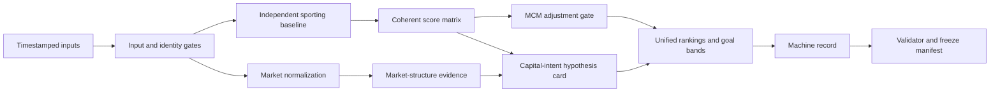

# MCM Odds Research Toolkit

An auditable, input-driven research toolkit for football probability and market-structure analysis.

MCM keeps three layers separate:

1. **Market-implied probability** — derived from complete quoted markets after removing the overround.
2. **Independent sporting baseline** — built without using the prices being audited.
3. **MCM-adjusted conclusion** — changes the independent baseline only when timestamped, non-market evidence passes contradiction checks.

The repository is designed to make uncertainty visible. Missing evidence produces an explicit downgrade instead of a fabricated prediction.

> **Research use only.** This project does not guarantee match outcomes or returns, does not provide financial advice, and does not treat bookmaker intent or manipulation as established fact.

[中文说明](docs/README.zh-CN.md) · [Methodology](docs/methodology.md) · [Public release audit](docs/public-release-audit.md)

## Why this project exists

Football-odds analysis often mixes observed prices, sporting assumptions, and causal stories. MCM turns those into separate, inspectable artifacts. Every fixture receives one status:

- `FULL-MCM`: all required evidence and audit gates are present.
- `MCM-DEGRADED`: the model is usable, but a material evidence gap remains.
- `MARKET-STRUCTURE-ONLY`: no independent sporting baseline is available.
- `BLOCKED`: identity, orientation, horizon, or another critical input is unresolved.

The capital-intent layer is deliberately conservative. It records attraction, protection, sporting feasibility, contradictions, and a with/without-capital counterfactual. It never changes probabilities by itself.

## Highlights

- Transparent Poisson score matrix with anti-circularity checks
- Sporting-baseline builder with venue rates, shrinkage, and data-lineage fields
- Separate market, independent, and adjusted probability layers
- Ordinary 1X2 and integer three-way handicap ranking from one score matrix
- Four mutually exclusive goal bands: `0–1`, `2–3`, `4–6`, and `7+`
- Capital-intent hypotheses with evidence grades and falsifiers
- Machine-readable fixture records and deterministic validation
- Append-only freeze manifests and observe-only research modules
- Standard-library-only Python core; no package installation required

## Architecture



## Quick start

Requires Python 3.10 or newer.

```bash
git clone https://github.com/chenqishi6688-ctrl/mcm-odds-research-toolkit.git
cd mcm-odds-research-toolkit
python -m unittest discover -s tests -v
```

Run the synthetic end-to-end example:

```bash
python scripts/full_mcm_pipeline.py examples/synthetic-full-mcm-batch.json --output demo-run
python scripts/freeze_manifest.py demo-run
```

The example intentionally produces `MCM-DEGRADED`: it includes a valid independent baseline but no artifact-bound live-monitoring proof. That is expected and demonstrates that the evidence gate cannot be bypassed by caller-supplied checkpoint counts.

A frozen sample result is included in [`examples/demo-output`](examples/demo-output).

## Useful commands

```bash
# Independent score model
python scripts/independent_score_matrix.py --self-test

# Build a baseline from completed-match history
python scripts/sporting_baseline_builder.py --self-test

# Validate machine-readable fixture records
python scripts/validate_report.py --self-test

# Audit market overround and settlement coverage
python scripts/market_quality.py
```

Every core command has an offline self-test. The continuous-integration workflow runs the complete smoke suite and the synthetic pipeline without network access.

## Repository layout

```text
.
├── scripts/              # Analysis, validation, and research CLIs
├── schemas/              # JSON data contracts
├── docs/
│   ├── methodology.md    # Public methodology overview
│   └── reference/        # Detailed execution rules
├── examples/
│   ├── synthetic-full-mcm-batch.json
│   └── demo-output/      # Validated, generated demonstration
└── tests/                # Offline smoke and end-to-end tests
```

## Evidence rules

- Facts, derived signals, hypotheses, and unknowns must be labeled separately.
- The independent baseline must not be reverse-engineered from the audited odds.
- A market-implied probability is never relabeled as an MCM prediction.
- Missing inputs stay missing; they are not interpolated after the result.
- “Capital intent,” “inducement,” and “protection” remain falsifiable hypotheses.
- Historical observations remain `observe_only` until chronological holdout tests support promotion.

See [docs/methodology.md](docs/methodology.md) for the full public contract.

## Data and privacy

No credentials, account identifiers, personal bankroll information, real user logs, or proprietary provider dumps are included. The example data are synthetic. If you add a data connector, keep credentials in environment variables and confirm that your license permits storage and redistribution.

## Project status

This is public release `0.1.0`, extracted from the MCM v1.10.2 methodology lineage. The public release number describes packaging maturity, not predictive performance. No hit-rate or profitability claim is made.

## License

MIT. See [LICENSE](LICENSE).


